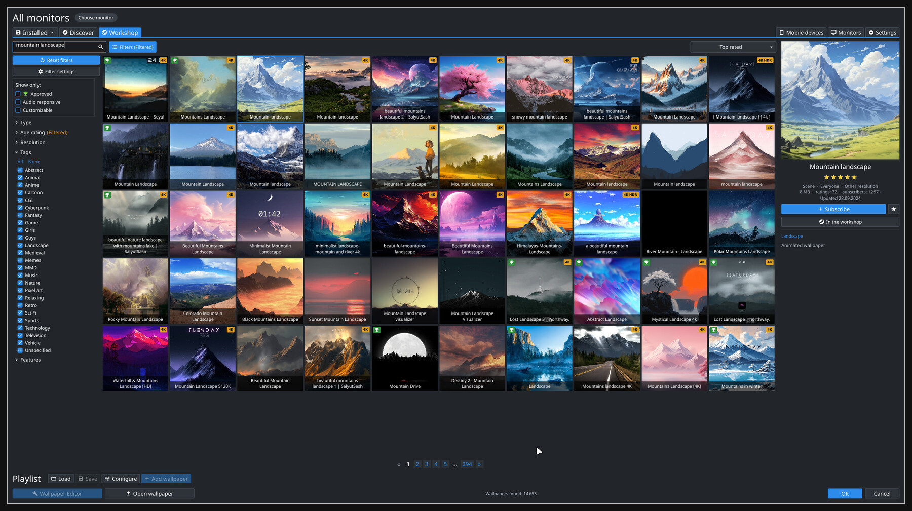
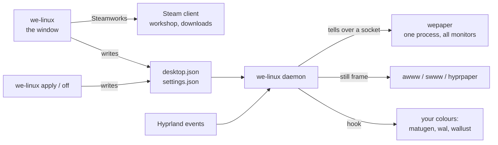

<div align="center">


# WE Linux

**Wallpaper Engine on Linux, the way the Windows client feels:<br>browse the workshop, subscribe, tune, and put it on your desktop.**

[](LICENSE)


[](#nixos)


[Install](#install) · [First run](#first-run) · [Hyprland](#hyprland) · [Command line](#command-line) · [Troubleshooting](#troubleshooting) · [Русский](README.ru.md)



</div>

## What it is

A native app (Rust + [Slint](https://slint.dev), no Electron, no Proton) laid out like Wallpaper
Engine's own window, plus a small daemon that keeps the wallpaper on your desktop.

- **The real workshop.** It talks to your running Steam client through Steamworks, as Wallpaper
  Engine itself does: search, the client's filters (type, age rating, resolution, tags,
  features), nine sort orders, 50 items a page, approved and 4K/HDR badges.
- **Subscribe and unsubscribe in place.** Steam downloads, the app shows the progress.
- **Your library.** Everything installed across all Steam libraries, with search, filters,
  favourites and recommendations from the genres you already have.
- **Wallpaper properties.** Checkboxes, sliders, colours, drop-downs and text of a wallpaper,
  applied to the running wallpaper at once and remembered per wallpaper.
- **Monitors.** One wallpaper everywhere, or a different one per monitor. Every monitor runs
  its own copy of the scene, so scripts that follow the pointer work per monitor.
- **Playlists.** Timed or random, saved and loaded, running in the background.
- **Light on the machine.** Rendering is done by [wepaper](https://github.com/MoonTiwzy/wepaper),
  a renderer written for exactly this: one process and one OpenGL context for all monitors,
  textures and video decoders shared between them, nothing running that no wallpaper needs.
  Changing a setting or a property never restarts it.

| One scene with a 4K video, one 1440p monitor | Video memory | Memory | CPU |
|---|---|---|---|
| WE Linux before wepaper | 108 MiB | 476 MB | 39% of a core |
| **WE Linux with wepaper** | **98 MiB** | **221 MB** | **19%** |

<sub>RTX 5070, 60 fps, the two measured one after the other on the same machine; yours will
differ. The video is decoded on the CPU at the monitor's size, once however many monitors show
it: a second monitor costs its surface (about 33 MiB of video memory) and no second decoder.
Decoding on the GPU is one switch in Settings. More wallpapers, measured one by one, are in
[wepaper's numbers](https://github.com/MoonTiwzy/wepaper/blob/main/docs/performance.md).</sub>

English and Russian: the app asks on the first start, and the language box in Settings
changes it later.

## Requirements

- **Wallpaper Engine, bought and installed in Steam.** Its `assets` folder holds the shaders
  every scene needs. Nothing of Wallpaper Engine is shipped here.
- **Steam running**, for the workshop tabs. The library and your wallpapers work without it.
- **One native Linux game installed in Steam** (any free one will do). Every native game
  carries Valve's `libsteam_api.so`; WE Linux finds it by itself and keeps a copy.
- **Wayland** with layer-shell. Hyprland is what it is developed and tested on; Sway, niri,
  river and KDE Plasma have the protocol it needs.
- OpenGL 3.3, and at run time `libmpv` (video and sound) and `ffmpeg` (cheaper copies of
  oversized videos).

## Install

### Any distro

```sh
git clone https://github.com/MoonTiwzy/we-linux
cd we-linux
./install.sh
```

One command builds WE Linux and the renderer and puts `we-linux` and `wepaper` in
`~/.local/bin`, with a menu entry. It needs Rust ([rustup.rs](https://rustup.rs)) and the usual
build tools; if the renderer does not build, the script prints the package list for Arch,
Fedora and Debian. The whole build takes about two minutes.

Web wallpapers are a plugin of the renderer (`wepaper-web`), built when GTK 4, WebKitGTK 6 and
gtk4-layer-shell are installed; `./install.sh --no-web` leaves it out.
`./install.sh --engine` rebuilds the renderer too, for an update.

### NixOS

Try it without installing anything:

```sh
nix run github:MoonTiwzy/we-linux
```

Or add it to your flake. The package brings the renderer, ffmpeg and the file dialog with it.

```nix
{
  inputs.we-linux.url = "github:MoonTiwzy/we-linux";

  outputs = { nixpkgs, we-linux, ... }: {
    nixosConfigurations.my-pc = nixpkgs.lib.nixosSystem {
      modules = [
        we-linux.nixosModules.default
        {
          programs.we-linux.enable = true;
          # Hyprland without UWSM: turn the service off and use exec-once (see below).
          # programs.we-linux.autostart = false;
        }
      ];
    };
  };
}
```

Home Manager works the same way: `we-linux.homeManagerModules.default` and
`services.we-linux.enable = true;`.

`nix flake check` boots a NixOS VM, starts a compositor in it and opens the window. Two things
on NixOS to know:

- The package was moved to the new renderer together with everything else and has not been
  built on a NixOS machine since. If it does not build for you, say so in an issue.
- The workshop tabs load Valve's `libsteam_api.so` from one of your games. The package puts
  `libstdc++` on its library path for it; if the workshop still says Steam does not answer, run
  WE Linux through `steam-run we-linux` and tell us in an issue.

## First run

1. Start Steam, then **WE Linux** from your menu (or `we-linux`).
2. Open **Workshop**, find something, press **Subscribe**.
3. When Steam has it, press **Set wallpaper**. Done.

To have the wallpaper come back after a login, start the daemon with your session:

| Compositor | Add this |
|---|---|
| Hyprland | `exec-once = we-linux daemon` |
| Sway | `exec we-linux daemon` |
| niri | `spawn-at-startup "we-linux" "daemon"` |
| NixOS module | nothing, the systemd user service does it |

You do not have to: the window and `we-linux apply` start the daemon when it is not running.

## Hyprland

WE Linux sets Hyprland up by itself. Nothing below needs a line in your config, it is here so
you know what happens.

**With awww, swww or hyprpaper.** Keep them. The live wallpaper is drawn on the same background
layer, and two programs on one layer are stacked in whatever order they started in, so a static
wallpaper that starts later would cover the live one. The daemon gives the engine's layer a
layer rule (`order -1`, fade in and out) so it stays on top either way, and hands your wallpaper
daemon a still frame of the live wallpaper. So the desktop shows the same picture before the
engine is up and while it is stopped. The picture you had before is remembered and comes back
on `we-linux off`, when the daemon is stopped and when a wallpaper fails to load. Turn the
still off with `"still": false` in the settings file if you want your own picture under it.

**Fullscreen.** A monitor that shows a fullscreen window (a game, a video) keeps the
wallpaper's last frame and does no work; when the desktop is back, the wallpaper goes on from
that frame. Other monitors keep playing. If you would rather give a game the video memory,
turn on "Stop the engine when every monitor is fullscreen" in Settings: then the scene starts
over afterwards.

**Colours from the wallpaper.** Set a hook and it runs on every wallpaper change with a still
frame to take colours from:

```jsonc
// ~/.config/we-linux/settings.json
{ "hook": "matugen image \"$WE_LINUX_STILL\"" }      // or: wal -i, wallust run
```

The hook gets `WE_LINUX_WALLPAPER` (the wallpaper's folder), `WE_LINUX_STILL` (a PNG or JPEG of
it) and `WE_LINUX_TITLE`.

<details>
<summary>What the daemon runs for the layer rule</summary>

```sh
# Lua config (Hyprland 0.55+)
hyprctl eval 'hl.layer_rule({ match = { namespace = "^(wepaper)$" }, order = -1, animation = "fade" })'
# older configs
hyprctl keyword layerrule "order -1, wepaper"
```

If your Hyprland takes neither, add the rule to your config by hand.
</details>

## Command line

```
we-linux                                  the window
we-linux apply <ID|PATH> [--output NAME]  a workshop id, a wallpaper folder, a video or a
                                          picture; on every monitor, or on one
we-linux off                              no live wallpaper
we-linux status                           what is on the desktop
we-linux doctor                           a full report for a bug: versions, what was found,
                                          the settings, the engine's log
we-linux workshop [TEXT] [--sort top|trend|new|subs|updated] [--type scene|video|web] [--page N]
                                          search the workshop: id, size, votes, title
we-linux subscribe ID...                  subscribe and wait for Steam to download
we-linux unsubscribe ID...                unsubscribe (Steam removes the files)
we-linux daemon                           keep the wallpaper on the desktop
```

```sh
we-linux apply 3409533530                 # a subscribed workshop item
we-linux apply ~/Videos/loop.mp4          # any video
we-linux apply 3409533530 --output DP-2   # only on one monitor
```

A picture is handed to awww, swww or hyprpaper, whichever runs (awww is the tested one).

## Settings

The window's **Settings** covers the language, the frame rate, where scene videos are decoded,
sound, fullscreen behaviour and the still frame, each with a hint on its (i). The file has the
same switches and the hook:

```jsonc
// ~/.config/we-linux/settings.json
{
  "fps": 60,                 // frame rate cap
  "video_gpu": false,        // decode scene videos on the GPU: less CPU, more video memory
  "audio": false,
  "volume": 50,
  "pause_fullscreen": true,  // Hyprland: freeze a monitor that shows a fullscreen window
  "stop_fullscreen": false,  // Hyprland: stop the engine while every monitor is fullscreen
  "still": true,             // give awww/swww/hyprpaper a still of the wallpaper
  "hook": ""                 // a shell command run when the wallpaper changes
}
```

| What | Where |
|---|---|
| The wallpaper on the desktop, per-monitor wallpapers | `~/.config/we-linux/desktop.json` |
| Changed properties of a wallpaper | `~/.config/we-linux/properties/<id>.json` |
| The playlist and saved playlists | `~/.config/we-linux/playlist.json`, `playlists/` |
| Preview and still caches | `~/.cache/we-linux/` |
| The renderer's log | `$XDG_RUNTIME_DIR/we-linux/engine.log` |

## Troubleshooting

Something does not work? Run `we-linux doctor` and read what it says is `NOT FOUND` or
`NOT RUNNING`; paste its output into an issue if that does not explain it.

| You see | Do this |
|---|---|
| The workshop tab says Steam does not answer | Start Steam and log in. Your account must own Wallpaper Engine. |
| "libsteam_api.so was not found" | Install any native Linux game in Steam (a free one is fine) and open WE Linux again. |
| A wallpaper is set but the desktop does not change | `we-linux status`. It prints the error: usually Wallpaper Engine itself is not installed in Steam (no `assets`), or `wepaper` is not on the PATH. Then look at the renderer's log. |
| The static wallpaper covers the live one | Hyprland: the daemon's layer rule did not take, add it by hand (above). Other compositors: start `we-linux daemon` after your wallpaper daemon. |
| The wallpaper is gone after a reboot | Start `we-linux daemon` with your session (First run). |
| The wallpaper freezes when a game starts | That is the fullscreen freeze, it goes on when the desktop is back. Turn it off in Settings to keep it running. |
| "did not start: not enough video memory" | The scene does not fit your graphics card with what else is open. Close something heavy (a browser with video, a game) and set it again, or pick a lighter wallpaper: 4K scenes with many layers are the expensive ones. |
| High CPU on a scene with a video | Lower the frame rate to 30, or switch video decoding to the GPU in Settings (costs video memory). |
| A scene looks wrong | Run `wepaper check <the wallpaper's folder>`: it names what the renderer leaves out and why. Report it to [wepaper](https://github.com/MoonTiwzy/wepaper/issues) with that output. |

## How it works



The window never draws a wallpaper. It writes what you picked to a file; the daemon reads it
and tells the renderer over its socket: this wallpaper on that monitor, this property, that
setting. The renderer keeps running through all of it; it starts once and stops when there is
nothing to show. The window itself renders in software: about 175 MB of RAM and no video
memory.

## Not there yet

- The wallpaper editor and sending wallpapers to a phone.
- Application wallpapers (Windows programs).

## Credits

- [wepaper](https://github.com/MoonTiwzy/wepaper): the renderer.
- [Slint](https://slint.dev) for the interface.
- [awww](https://codeberg.org/LGFae/awww), swww and hyprpaper, which it plays nicely with.

## License

[MIT](LICENSE). WE Linux is an independent project and is not affiliated with Wallpaper Engine
or Valve. Wallpaper Engine is a trademark of its owner; you need your own copy of it.
