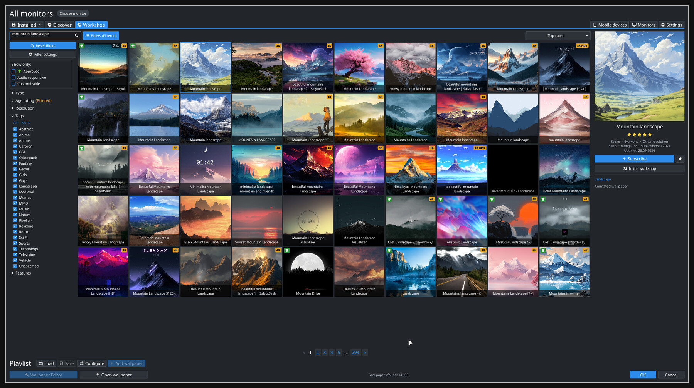
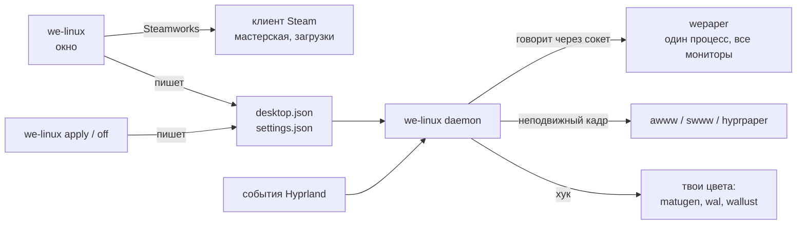

<div align="center">


# WE Linux

**Wallpaper Engine на Linux, каким его привыкли видеть в Windows:<br>листай мастерскую, подписывайся, настраивай и ставь на рабочий стол.**

[](LICENSE)


[](#nixos)


[Установка](#установка) · [Первый запуск](#первый-запуск) · [Hyprland](#hyprland) · [Командная строка](#командная-строка) · [Если что-то не так](#если-что-то-не-так) · [English](README.md)



</div>

## Что это

Нативное приложение (Rust + [Slint](https://slint.dev), без Electron и без Proton), собранное
как окно самого Wallpaper Engine, плюс небольшой демон, который держит обои на рабочем столе.

- **Настоящая мастерская.** Приложение говорит с запущенным клиентом Steam через Steamworks,
  как и сам Wallpaper Engine: поиск, фильтры клиента (тип, возрастной рейтинг, разрешение,
  теги, возможности), девять сортировок, 50 позиций на странице, значки «одобрено» и 4K/HDR.
- **Подписка и отписка на месте.** Скачивает Steam, приложение показывает прогресс.
- **Твоя библиотека.** Всё установленное во всех библиотеках Steam, с поиском, фильтрами,
  избранным и рекомендациями по жанрам, которые у тебя уже есть.
- **Свойства обоев.** Галочки, ползунки, цвета, списки и текст обоев применяются к играющим
  обоям сразу и запоминаются для каждых обоев отдельно.
- **Мониторы.** Одни обои на всех или разные на каждом. На каждом мониторе играет своя копия
  сцены, так что скрипты, которые следят за указателем, работают на каждом мониторе отдельно.
- **Плейлисты.** По таймеру или случайные, с сохранением и загрузкой, работают в фоне.
- **Бережно к железу.** Рисует [wepaper](https://github.com/MoonTiwzy/wepaper), рендерер,
  написанный ровно под эту задачу: один процесс и один контекст OpenGL на все мониторы,
  текстуры и декодеры видео общие для них, и ничего не работает, пока этого не просят обои.
  Смена настройки или свойства никогда его не перезапускает. Он быстрый: обои появляются за
  доли секунды и берут мало памяти, видеопамяти и процессора. Видео декодируется один раз,
  сколько бы мониторов его ни показывало, по умолчанию на CPU; декодирование на GPU включается
  одним переключателем в настройках.

Английский и русский: приложение спрашивает язык при первом запуске, а потом он меняется в
настройках.

## Что нужно

- **Wallpaper Engine, купленный и установленный в Steam.** В его папке `assets` лежат шейдеры,
  которые нужны каждой сцене. Ничего из Wallpaper Engine здесь не поставляется.
- **Запущенный Steam** для вкладок мастерской. Библиотека и обои работают и без него.
- **Одна нативная игра для Linux, установленная в Steam** (подойдёт любая бесплатная). В
  каждой нативной игре есть `libsteam_api.so` от Valve; WE Linux находит её сам и хранит копию.
- **Wayland** с layer-shell. Разрабатывается и проверяется на Hyprland; нужный протокол есть
  в Sway, niri, river и KDE Plasma.
- OpenGL 3.3, а во время работы `libmpv` (видео и звук) и `ffmpeg` (дешёвые копии слишком
  больших видео).

## Установка

### Любой дистрибутив

```sh
git clone https://github.com/MoonTiwzy/we-linux
cd we-linux
./install.sh
```

Одна команда собирает WE Linux и рендерер и кладёт `we-linux` и `wepaper` в `~/.local/bin`,
вместе с пунктом в меню. Нужен Rust ([rustup.rs](https://rustup.rs)) и обычные инструменты
сборки; если рендерер не собирается, скрипт печатает список пакетов для Arch, Fedora и Debian.
Вся сборка занимает около двух минут.

Веб-обои это плагин рендерера (`wepaper-web`), он собирается, если установлены GTK 4,
WebKitGTK 6 и gtk4-layer-shell; `./install.sh --no-web` его пропускает.
Рендерер берётся ровно тем коммитом, что записан в `flake.lock`, тем же, с которым собирается
пакет Nix: если после `git pull` пин сдвинулся, следующий `./install.sh` пересоберёт рендерер, а
если нет, не тронет. `./install.sh --engine` пересобирает его в любом случае.

### NixOS

Попробовать, ничего не устанавливая:

```sh
nix run github:MoonTiwzy/we-linux
```

Или добавить в свой flake. Пакет приносит с собой рендерер, ffmpeg и диалог выбора файлов.

```nix
{
  inputs.we-linux.url = "github:MoonTiwzy/we-linux";

  outputs = { nixpkgs, we-linux, ... }: {
    nixosConfigurations.my-pc = nixpkgs.lib.nixosSystem {
      modules = [
        we-linux.nixosModules.default
        {
          programs.we-linux.enable = true;
          # Hyprland без UWSM: выключи сервис и используй exec-once (см. ниже).
          # programs.we-linux.autostart = false;
        }
      ];
    };
  };
}
```

Home Manager подключается так же: `we-linux.homeManagerModules.default` и
`services.we-linux.enable = true;`.

`nix flake check` поднимает виртуальную машину с NixOS, запускает в ней композитор и
открывает окно. Про NixOS стоит знать две вещи:

- Пакет собирается, а тест в виртуальной машине прогоняется при каждом пуше (см. CI). Если у
  тебя он всё равно не собирается, напиши об этом в issue.
- Вкладки мастерской загружают `libsteam_api.so` от Valve из одной из твоих игр. Пакет кладёт
  для неё `libstdc++` в путь библиотек; если мастерская всё равно говорит, что Steam не
  отвечает, запусти WE Linux через `steam-run we-linux` и расскажи нам в issue.

## Первый запуск

1. Запусти Steam, затем **WE Linux** из меню (или `we-linux`).
2. Открой **Мастерскую**, найди что-нибудь, нажми **Подписаться**.
3. Когда Steam скачает, нажми **Установить обои**. Готово.

Чтобы обои возвращались после входа в систему, запускай демон вместе с сессией:

| Композитор | Добавь это |
|---|---|
| Hyprland | `exec-once = we-linux daemon` |
| Sway | `exec we-linux daemon` |
| niri | `spawn-at-startup "we-linux" "daemon"` |
| Модуль NixOS | ничего, это делает пользовательский сервис systemd |

Можно и не делать этого: окно и `we-linux apply` сами запускают демон, если он не работает.

## Hyprland

WE Linux настраивает Hyprland сам. Ничего из написанного ниже не требует строк в твоём
конфиге, это здесь для того, чтобы ты знал, что происходит.

**С awww, swww или hyprpaper.** Оставь их. Живые обои рисуются на том же фоновом слое, а две
программы на одном слое лежат в том порядке, в каком запустились, так что статичные обои,
запущенные позже, закрыли бы живые. Демон даёт слою рендерера правило (`order -1`, плавное
появление и исчезновение), чтобы он был сверху в любом случае, и отдаёт твоему демону обоев
неподвижный кадр живых обоев. Поэтому рабочий стол показывает одну и ту же картинку и до
запуска рендерера, и пока он остановлен. Картинка, которая была у тебя раньше, запоминается и
возвращается по `we-linux off`, при остановке демона и когда обои не смогли загрузиться.
Неподвижный кадр выключается через `"still": false` в файле настроек, если под живыми обоями
хочется оставить свою картинку.

**Полный экран.** Монитор, на котором открыто полноэкранное окно (игра, видео), держит
последний кадр обоев и не делает никакой работы; когда рабочий стол возвращается, обои
продолжают с этого кадра. Остальные мониторы играют дальше. В настройках, в «Воспроизведении»,
те же варианты, что у оригинала, для полноэкранного окна, развёрнутого, окна в фокусе, чужого
звука и спящего монитора: продолжать, заглушить, пауза (на мониторе или все) или остановить,
что отдаёт игре видеопамять, когда остановлены все мониторы (сцена потом начнётся заново).

**Цвета из обоев.** Задай хук, и он будет запускаться при каждой смене обоев с неподвижным
кадром, из которого можно взять цвета:

```jsonc
// ~/.config/we-linux/settings.json
{ "hook": "matugen image \"$WE_LINUX_STILL\"" }      // или: wal -i, wallust run
```

Хук получает `WE_LINUX_WALLPAPER` (папка обоев), `WE_LINUX_STILL` (их PNG или JPEG) и
`WE_LINUX_TITLE`. Что он печатает, уходит в `$XDG_RUNTIME_DIR/we-linux/hook.log` (вывод
последнего запуска), а не в терминал, из которого запущен демон.

<details>
<summary>Что демон выполняет для правила слоя</summary>

```sh
# Конфиг на Lua (Hyprland 0.55+)
hyprctl eval 'hl.layer_rule({ match = { namespace = "^(wepaper)$" }, order = -1, animation = "fade" })'
# старые конфиги
hyprctl keyword layerrule "order -1, wepaper"
```

Если твой Hyprland не принимает ни то, ни другое, добавь правило в конфиг руками.
</details>

## Командная строка

```
we-linux                                  окно
we-linux apply <ID|ПУТЬ> [--output ИМЯ]   id из мастерской, папка обоев, видео или картинка;
                                          на всех мониторах или на одном
we-linux off                              без живых обоев
we-linux status                           что сейчас на рабочем столе
we-linux doctor                           полный отчёт для бага: версии, что найдено,
                                          настройки, лог рендерера
we-linux workshop [ТЕКСТ] [--sort top|trend|new|subs|updated] [--type scene|video|web] [--page N]
                                          поиск по мастерской: id, размер, голоса, название
we-linux subscribe ID...                  подписаться и дождаться, пока Steam скачает
we-linux unsubscribe ID...                отписаться (Steam удалит файлы)
we-linux daemon                           держать обои на рабочем столе
```

```sh
we-linux apply 3409533530                 # позиция из мастерской, на которую есть подписка
we-linux apply ~/Videos/loop.mp4          # любое видео
we-linux apply 3409533530 --output DP-2   # только на одном мониторе
```

Картинка отдаётся awww, swww или hyprpaper, смотря что запущено (проверено с awww).

## Настройки

Вкладка **Настройки** в окне покрывает язык, частоту кадров, место декодирования видео в
сценах, звук, воспроизведение под другими окнами и неподвижный кадр, у каждого пункта есть подсказка
под указателем. В файле те же переключатели и хук:

```jsonc
// ~/.config/we-linux/settings.json
{
  "fps": 60,                 // предел частоты кадров
  "video_gpu": false,        // декодировать видео сцен на GPU: меньше CPU, больше видеопамяти
  "audio": false,
  "volume": 50,
  // «Воспроизведение»: "run", "mute", "pause" (этот монитор), "pauseall" или "stop"
  "playback_fullscreen": "pause",  // Hyprland: на мониторе полноэкранное окно
  "playback_maximized": "run",     // Hyprland: окно развёрнуто на монитор
  "playback_focus": "run",         // Hyprland: на мониторе окно в фокусе
  "playback_audio": "run",         // другая программа играет звук (pactl)
  "playback_sleep": "run",         // Hyprland: питание монитора выключено
  "still": true,             // отдавать awww/swww/hyprpaper неподвижный кадр обоев
  "hook": ""                 // команда оболочки, которая запускается при смене обоев
}
```

| Что | Где |
|---|---|
| Обои на рабочем столе, обои по мониторам | `~/.config/we-linux/desktop.json` |
| Изменённые свойства обоев | `~/.config/we-linux/properties/<id>.json` |
| Плейлист и сохранённые плейлисты | `~/.config/we-linux/playlist.json`, `playlists/` |
| Кэши превью и неподвижных кадров | `~/.cache/we-linux/` |
| Лог рендерера | `$XDG_RUNTIME_DIR/we-linux/engine.log` |
| Что хук напечатал в последний раз | `$XDG_RUNTIME_DIR/we-linux/hook.log` |

## Если что-то не так

Что-то не работает? Запусти `we-linux doctor` и посмотри, что у него `NOT FOUND` или
`NOT RUNNING`; если это ничего не объясняет, приложи его вывод к issue.

| Что видишь | Что делать |
|---|---|
| Вкладка мастерской пишет, что Steam не отвечает | Запусти Steam и войди. На аккаунте должен быть Wallpaper Engine. |
| «libsteam_api.so was not found» | Установи в Steam любую нативную игру для Linux (подойдёт бесплатная) и открой WE Linux снова. |
| Обои выбраны, а рабочий стол не меняется | `we-linux status`. Он печатает ошибку: обычно сам Wallpaper Engine не установлен в Steam (нет `assets`) или `wepaper` нет в PATH. Потом загляни в лог рендерера. |
| Статичные обои закрывают живые | Hyprland: правило слоя от демона не применилось, добавь его руками (выше). Другие композиторы: запускай `we-linux daemon` после своего демона обоев. |
| Обои пропали после перезагрузки | Запускай `we-linux daemon` вместе с сессией (Первый запуск). |
| Обои замирают при запуске игры | Это заморозка при полном экране, она проходит, когда возвращается рабочий стол. Выключи её в настройках, если хочешь, чтобы обои играли дальше. |
| «did not start: not enough video memory» | Сцена не помещается в видеокарту вместе с тем, что ещё открыто. Закрой что-нибудь тяжёлое (браузер с видео, игру) и поставь обои снова или выбери обои полегче: дороже всего 4K-сцены с множеством слоёв. |
| Высокая загрузка CPU на сцене с видео | Понизь частоту кадров до 30 или переключи декодирование видео на GPU в настройках (стоит видеопамяти). |
| Сцена выглядит неправильно | Запусти `wepaper check <папка обоев>`: он назовёт, что рендерер пропускает и почему. Сообщи об этом в [wepaper](https://github.com/MoonTiwzy/wepaper/issues), приложив вывод. |

## Как это устроено



Окно никогда не рисует обои. Оно записывает твой выбор в файл; демон его читает и говорит
рендереру через его сокет: эти обои на тот монитор, это свойство, эта настройка. Рендерер при
этом продолжает работать: он запускается один раз и останавливается, когда показывать нечего.
Само окно рисуется программно: около 175 МБ оперативной памяти и ноль видеопамяти.

## Чего пока нет

- Редактора обоев и отправки обоев на телефон.
- Обоев-приложений (программ для Windows).

## Благодарности

- [wepaper](https://github.com/MoonTiwzy/wepaper): рендерер.
- [Slint](https://slint.dev) за интерфейс.
- Иконки: [Font Awesome Free](https://fontawesome.com) 6.7.2 от Fonticons, Inc., лицензия
  [CC BY 4.0](https://creativecommons.org/licenses/by/4.0/) (в `ui/icons.slint` их контуры без изменений).
- [awww](https://codeberg.org/LGFae/awww), swww и hyprpaper, с которыми WE Linux дружит.

## Лицензия

[MIT](LICENSE). WE Linux это независимый проект, он не связан с Wallpaper Engine и Valve.
Wallpaper Engine это торговая марка её владельца; нужна своя копия.
